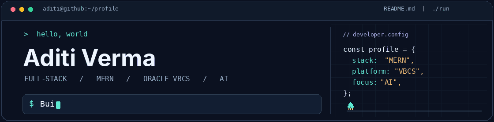

<div align="center">



<h1>Hi, I'm Aditi Verma </h1>

<h3>Full-Stack Developer | MERN Stack | Oracle VBCS | AI Integration</h3>

<p>
  <code>Build.</code> &nbsp;
  <code>Debug.</code> &nbsp;
  <code>Optimize.</code> &nbsp;
  <code>Repeat.</code>
</p>

<a href="https://www.linkedin.com/in/aditi-verma-1b8667258/">
  
</a>
<a href="https://leetcode.com/aditiv__/">
  
</a>
<a href="https://github.com/aditiverma13">
  
</a>

<br /><br />

<a href="#about">01 / About</a> &nbsp; • &nbsp;
<a href="#featured-projects">02 / Projects</a> &nbsp; • &nbsp;
<a href="#tech-stack">03 / Stack</a> &nbsp; • &nbsp;
<a href="#experience">04 / Experience</a> &nbsp; • &nbsp;
<a href="#achievements">05 / Achievements</a>

</div>

---

## 01 / About

I'm a software developer with hands-on experience building **full-stack web applications, enterprise workflows, and AI-integrated products**.

I enjoy working across frontend and backend systems, building reliable APIs, solving technical problems, and creating practical user experiences.

```js
const aditi = {
  currently: "Technical Trainee @ Proso.ai",
  previously: "Software Developer Intern @ AeonX Digital",
  focus: ["Full-Stack Development", "Enterprise Solutions", "AI Integration"],
  technologies: ["MERN", "Oracle VBCS", "ORDS", "REST APIs"],
  education: "B.Tech ECE - MMMUT Gorakhpur",
  problemSolving: "600+ DSA Problems",
  mindset: "Keep building. Keep learning."
};
```

<details>
<summary><b>+ More about what I do</b></summary>

- **Currently:** Working on Oracle VBCS, JavaScript Action Chains, ORDS and REST APIs at Proso.ai.
- **Previously:** Worked with React.js, Node.js and Express.js at AeonX Digital.
- **Projects:** Built AI-powered applications using MERN, Gemini AI, Firebase and REST APIs.
- **Problem Solving:** Solved 600+ DSA problems across coding platforms.
- **Education:** B.Tech in Electronics and Communication Engineering, MMMUT Gorakhpur.

</details>

---

## 02 / Featured Projects

<table>
<tr>
<td width="50%" valign="top">

### 🎓 EduCrafted
**AI-Powered Learning Management System**

`MERN` `Redux Toolkit` `Firebase` `Gemini AI`

A full-stack learning platform with student and instructor dashboards, role-based access control, AI-powered course discovery, secure authentication and payment integration.

<br />

<a href="https://github.com/aditiverma13/LMS"></a>
<a href="https://lms-1-nczd.onrender.com/"></a>

<details>
<summary><b>Explore Features</b></summary>

<ul>
<li>Role-based course management and enrollment.</li>
<li>Gemini AI-powered course search.</li>
<li>Firebase Authentication and Razorpay integration.</li>
<li>REST APIs with MongoDB-backed data management.</li>
</ul>

</details>

</td>

<td width="50%" valign="top">

### 🤖 AI Virtual Assistant
**Voice-Enabled AI Assistant**

`MERN` `Gemini AI` `Tailwind` `REST APIs`

A voice-enabled AI assistant supporting conversational interactions, real-time information retrieval, weather, news, and search.

<br />

<a href="https://github.com/aditiverma13/virtual-assistant-p3"></a>
<a href="https://virtual-assistant-9zq4.onrender.com/"></a>

<details>
<summary><b>Explore Features</b></summary>

<ul>
<li>AI-powered natural-language responses.</li>
<li>Voice interaction and multiple API integrations.</li>
<li>Secure authentication and responsive interface.</li>
<li>Full-stack application deployed on Render.</li>
</ul>

</details>

</td>
</tr>
</table>

<details>
<summary><b>+ Explore More Projects</b></summary>

### ScaleEdge Studio
Responsive digital agency landing page using React, Tailwind CSS, Framer Motion and Swiper.js.

[View Source Code](https://github.com/aditiverma13/ScaleEdge--Studio)

### LearnSphere
Multi-page educational website developed using HTML5, CSS3 and responsive layouts.

[View Source Code](https://github.com/aditiverma13/Learnsphere)

</details>

---

## 03 / Tech Stack

<div align="center">


</div>

<br />

<details>
<summary><b>+ View Complete Technology Map</b></summary>

| Area | Technologies |
|:---|:---|
| **Frontend** | React.js, Redux Toolkit, Tailwind CSS, HTML5, CSS3 |
| **Backend** | Node.js, Express.js, REST APIs, JWT |
| **Database** | MongoDB, MySQL, PostgreSQL, Firebase |
| **Enterprise** | Oracle VBCS, ORDS, JavaScript Action Chains |
| **Languages** | JavaScript, Python, C++, SQL |
| **Tools** | Git, GitHub, Postman, Render, Vercel |

</details>

---

## 04 / Experience

<table>
<tr>
<td width="50%" valign="top">

### 💼 Proso.ai

**Technical Trainee**

`July 2026 – Present`

Working on enterprise timecard workflows using Oracle VBCS, JavaScript and ORDS APIs, with a focus on UI development, API integration, validation and debugging.

</td>

<td width="50%" valign="top">

### 💻 AeonX Digital

**Software Developer Intern**

`October 2025 – December 2025`

Developed authentication workflows, connected React components with Node.js/Express APIs and resolved frontend-backend integration issues.

</td>
</tr>
</table>

---

## 05 / Achievements

<div align="center">

<table>
<tr>
<td align="center" width="33%">

<h2>600+</h2>

<b>DSA Problems</b>

<sub>Solved across coding platforms</sub>

</td>

<td align="center" width="34%">

<h2>#650</h2>

<b>LeetCode Weekly 451</b>

<sub>Global Rank / 26,806</sub>

</td>

<td align="center" width="33%">

<h2>#143</h2>

<b>CodeChef Starters 191</b>

<sub>Global Rank / 29,282</sub>

</td>
</tr>
</table>

</div>

<details>
<summary><b>+ Certifications & Coding Profiles</b></summary>

### Certifications

- **Machine Learning** — IIT Madras (NPTEL)
- **Internet of Things** — IIT Kharagpur (NPTEL)

### Coding Profiles

- [LeetCode](https://leetcode.com/aditiv__/)
- [CodeChef](https://www.codechef.com/users/aditi_v13)
- [GeeksforGeeks](https://auth.geeksforgeeks.org/user/aditi131qpki)

</details>

---

<details>
<summary><b>📊 View Live GitHub Activity</b></summary>

<br />

<div align="center">


</div>

</details>

---

<div align="center">

<h3>Let's Connect 🤝</h3>

Interested in full-stack development, enterprise solutions, AI integrations and collaborative software projects.

<a href="https://www.linkedin.com/in/aditi-verma-1b8667258/">LinkedIn</a>
&nbsp; • &nbsp;
<a href="https://github.com/aditiverma13">GitHub</a>

<br /><br />

<sub><code>Building, learning and improving.</code></sub>

</div>
